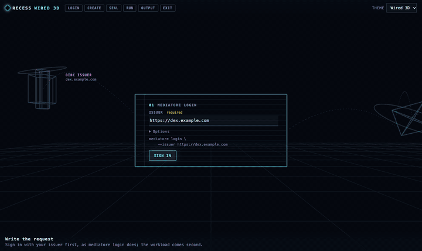

<!-- Copyright (c) 2026 Erick Bourgeois, Recess -->
<!-- SPDX-License-Identifier: Apache-2.0 -->

# Recess

*Where agents go to play.*



*`recess web --view agentsandbox --demo`, at 2.2× speed. The whole tour at real speed:
[docs/media/agentsandbox.mp4](docs/media/agentsandbox.mp4).*

Walk one workload through mediatore and watch each stage happen, in a browser or a terminal.
The stages follow the `mediatore` CLI's process:

1. **`mediatore login`**: the first thing on the page is its form, with every option the CLI
   takes (the issuer is required; client id, scopes, auth params, login hint, CA file, client
   secret file, redirect ports, host and path, `--no-browser`) and the exact command it is
   equivalent to, live as you type. **Log in** mints the token: OIDC with PKCE at the issuer.
   Then it shows the session file (path, mode), the ID token's claims and your groups.
2. **`mediatore sandbox create`**: the workload and the claim's options, with its command.
   **Run** is enabled once the token is minted (one login per claim, as the CLI); the broker
   creates the `AgentSandbox`.
3. **Seal credentials**: the refresh token and any delegated credentials, sealed into
   Secrets in the broker's namespace. A live map shows every secret of the claim in red, where it
   is (your machine, the Kubernetes API, the broker, the sandbox VM, the egress gateways), with
   a 🔒 when it is sealed at rest and `RAM` when it only ever lives in memory.
4. **Run in the sandbox**: the guest's own order (claim a VM, bound, claim identity registered,
   guest attested, sandbox built, nsjail enter → `jail-exec` → exec, running, exit reported,
   released). Each sub-step is `observed` (a field appeared on the `AgentSandbox`), `reported`
   (the guest's report or exit) or `inferred` (no event of its own). The sandbox VM and the
   egress gateway VMs come from the Kubernetes API, with their addresses.
5. **Output**: the workload's stdout and stderr as it runs (`--logs` on the claim).
6. **Exit code**, and where the time went.

It drives mediatore's own client crate (`mediatore-client`, `mediatore-proto`, git
dependencies pinned to a commit of `firestoned/mediatore`) for the login, the claim and the output, and
the Kubernetes API (kube-rs) for the `AgentSandbox`, its Events, the VMs and the Secrets'
metadata.

## Run

```sh
cargo build --release

# Browser: listens on loopback, prints a link carrying a one-time key, opens it.
MEDIATORE_ISSUER=https://dex.example.com MEDIATORE_URL=https://mediatore.example.com \
  ./target/release/recess web --namespace sandboxes

# The same, opening on the wireframe 3D journey; the page's View menu switches either way.
./target/release/recess web --view agentsandbox --namespace sandboxes

# Every live agent in the cluster, read-only (also at /watch on any recess web).
./target/release/recess web --view watch

# Terminal: the same two forms (login, then sandbox create) with every option and buttons.
./target/release/recess tui --namespace sandboxes

# No cluster: a scripted run with placeholder values, for showing the flow.
./target/release/recess web --demo
./target/release/recess web --view agentsandbox --demo
./target/release/recess web --view watch --demo
./target/release/recess tui --demo
```

The page keeps one stage in focus at a time. When a stage completes, its card shrinks into a
node on the rail at the left and the next stage pops up; stages that start together take turns.
Hover a node for its summary, click it to bring it back into focus ("Back to live" returns).
A claim the broker refuses shows its error code, detail and what to do about it. `#run` (any
stage id) in the URL opens the page on that stage.

While a claim waits for a VM, the Run card shows the pool (available, claimed, provisioning,
which member is booting and for how long) and banlieue's own reason from the claim's `Bound`
condition. A step that makes no progress past its limit (bind 2 min, guest build 2 min, ...)
is flagged with what it waits for; the workload's own run has no limit.

The network graph puts the sandbox VM on top and one arrow down to the egress gateways, laid
out side by side, then the destinations (the audiences the workload named). The guest's egress
proxy picks a gateway per connection (random start, failover), and which one carried a tunnel
is not observable from Kubernetes today, so the arrow meets the whole row; a workload that
names no audience opens no tunnel and its arrow is dashed.

Under the rail, "your recent sandboxes" lists the AgentSandboxes whose subject is the identity
in the session file, newest first, with how each ended (exit code, failure, still waiting).

## The 3D page

The View menu at the top of every page picks what it shows: **Classic** (your run as stage
cards), **AgentSandbox** (your run as a 3D journey; `--view agentsandbox`) or **Admin**
(every live agent in the cluster; `--view admin`, or `/admin`). The names they had before,
`wired-3d` and `watch` (and `/watch`), are still accepted.
They share the same API and guards, and your run lives on the server, so switching in the
middle of a run reloads the page onto it; the choice is remembered, and `--view`
(`RECESS_VIEW`; `--theme` and `RECESS_THEME` are its old names) sets the one a browser sees
first. Both 3D views stand on one base theatre (`assets/theatre.js`): the renderer, the shapes,
and the infrastructure in the same places, the issuer, the broker, the Kubernetes API and its
Secrets vault, the SandboxPolicy under its ExposureCeiling, OpenBao and SPIRE, and the three
places a claim is authorized (shields: the broker's admission, the API's admission and the
reconciler, the gateway's authorizer). AgentSandbox shows the run as a wireframe
journey. The request starts as a sheet of paper: sign in with the issuer first (the issuer
stamps the sheet), then write the workload and press "Seal and send". The sheet crumples into
an envelope with an open lock and travels to the broker (`POST /v1/claims`), on to the
Kubernetes API (the AgentSandbox), where the lock closes as the credentials are sealed into
Secrets. It then goes to the sandbox VM the pool bound, opens into the nsjail cage, and the
workload's output floats up. The exit code is carried to the last ring.

### Drilling in

Once the sheet is sent, the scene is a theatre you can move around, during the run and after
it. Click any node or edge (or its label, a stage chip in the bar, or a button in the
inspector's jump list): the camera flies there and the inspector on the right shows it, from
the top down: its name and what it is, then the facts at a glance, then layers. A protocol
hop is drawn as a stack (what rides on what: HTTP, TLS, the certificate chain, TCP); a
component as a nest (what runs inside what: the VM, the SPIRE agent, the guest agent, the
sandbox filesystem, nftables, the egress proxy, nsjail, jail-exec, the workload).

The nodes: you, the OIDC issuer, the broker, the Kubernetes API, the Secrets vault, the
sandbox VM with its guest agent, egress proxy and nsjail cage, each egress gateway, each
audience the workload named, and the exit. The edges: every hop between them, including the
jail to the proxy (loopback 3128, the only connection the jail may open), the proxy to a
gateway (a CONNECT tunnel over mutual TLS, as the claim) and the gateway to the audience. The
policy's: its ExposureCeiling bounds it (notaio lints it against the ceiling before it signs),
its bundle goes to the broker's admission, the reconciler holds the sandbox to it, and the
broker serves the gateway's authorizer the claim's allowlist built from it. Every raw (YAML)
block has a copy button.

Every fact carries how it is known:

| Tag | Meaning |
|---|---|
| seen | Recess saw it: its own TLS handshake, the Kubernetes objects it watches, the session file |
| reported | mediatore or the guest reported it (the build, the exit, the workload as accepted) |
| derived | built from what was seen with mediatore's naming rules (the claim's SPIFFE ID) |
| by design | what mediatore's code at the pinned version does (the sandbox leg is TLS 1.3, X25519MLKEM768, AES-256-GCM only; Landlock connects to 3128 only; ...) |
| demo | the demo's script, in `--demo` |

The TLS of the broker and the issuer is not assumed: Recess makes its own handshake with
each (the same client configuration as the CLI) and shows the negotiated version, cipher
suite, key exchange, ALPN and the presented chain (subject, names, key, signature, validity).
It dials only those two, and keeps the answer a minute.

Double-click the Secrets vault to open it: its door swings open on a wall of safety deposit
boxes, one per Secret in the broker's namespace, named for what they hold (`session`,
`delegation · anthropic`, `output 1`). Click a box to slide it out and see its full name, its
labels, its seal and who may open it; Recess reads names, labels and annotations, never the
data. Double-click again to close it.

The gateway that carries the claim's tunnels is drawn in pink, with the tunnel solid, when the
run's data says which one it is. mediatore does not report it today (the guest's egress proxy
logs it inside the VM, and the gateways look alike to the broker), so in a live run every
gateway is a candidate, dashed, and the details say why; the demo's scripted world names one.

| Input | Does |
|---|---|
| click | pick a node or an edge |
| double-click | open or close the vault; elsewhere, reset the orbit |
| drag | orbit |
| right-drag, shift-drag, Cmd-drag, W A S D | pan |
| scroll, + and - | zoom |
| arrow keys | orbit |
| `[` and `]` | the previous or next node |
| Esc, "Follow live" | hand the camera back to the run |
| Ctrl-drag, Option-drag, Ctrl-click then click | move a station ([Arranging the theatre](#arranging-the-theatre)) |

The renderer is a small one on a 2D canvas, with no 3D library and nothing loaded from
elsewhere; `prefers-reduced-motion` shortens every animation. It draws only when something
changes (your input, data from the cluster, the run moving on), and once a second for the clock
otherwise: an idle page costs next to nothing, and nothing spins or drifts on its own.

### Arranging the theatre

Both 3D views let you move what stands in them, and keep where you left it.

| Input | Does |
|---|---|
| Ctrl-drag or Option-drag | move the station under the pointer, and let go where it goes |
| Ctrl-click, then click | take it up, and drop it with the next click: it follows the pointer in between, no button held |
| Esc, while carrying | put it back where it was before this move |
| Ctrl-double-click | put it back where Recess stands it |
| Shift, with any of these | swap the plane it moves in (below) |
| Cmd-click | mark it, or unmark it (a dashed outline on its label) |
| Shift-Cmd-drag | draw a square: everything movable inside it is marked, in place of what was; a Shift-Cmd-click, or Esc, clears the marks |
| Ctrl-drag or Option-drag on a marked one | move everything marked together, by the same amount; Esc puts them all back |

A station moves across the floor while the camera looks down on it, and in the upright plane
facing you while the camera looks level (as on AgentSandbox's first view, with sheet 01 square
to you): that is how the OIDC tower goes up or down beside the login form. Its label and its
edges go with it, and so does whatever stands on it: the VM takes its guest agent, egress
proxy, gateways and audiences; your card takes its rolodex. In Admin, a namespace moves whole: an
agent, or its plot's name, takes the plot with every agent on it; a VM, a pool's name, or the
yard's name takes that namespace's yard of pools with every rack and VM in it (a rack never
leaves its yard). The gateways move as one column with their circle, and the audiences as one
block. Names are grabbed the same way as the things they name. Policies, providers and the
base stations move one at a time. To move several together, in either view, mark them first
(Cmd-click each, or a Shift-Cmd square round them): a move of any marked one carries them all,
each still saved under its own key. In Admin a mark takes the whole group, as a move does. The camera stays put while you move something.

Each move is saved as you let go, to `layout.json` beside `config.env`
(`$XDG_CONFIG_HOME/recess/`, else `~/.config/recess/`): per view, an offset from where the code
stands each thing, by node or group (`spire`, `issuer`, `gateways`, `ns/team-a`, ...). The next
load, of either view, stands everything there again. Delete the file, or a view's entry in it,
to start over. A station the code later moves keeps your offset from its new place.

A shared Recess ([In a cluster](#in-a-cluster)) shows the layout as shipped and saves nothing;
the "ctrl- or ⌥-drag to move" hint in the caption shows only where moves are kept.

### Recording it

`make record` rebuilds the GIF and MP4 above: it runs the demo with placeholder values only
(an empty config, `example.com` URLs), drives it in headless Chrome
(`scripts/record-agentsandbox.mjs`) and encodes with ffmpeg. It needs node, ffmpeg and Chrome or
Chromium (`CHROME` names the binary). `RECESS_DEMO_PACE` slows the demo (3 for the
recording; 1, the default, is the scripted speed).

## The Admin view

Admin (`--view admin`, `/admin`) shows every live agent your kubeconfig may see, in the same theatre as your run. East of
the Kubernetes API, each namespace is a plot and each AgentSandbox a cage on it: cyan running,
dashed grey pending, amber with policy gaps, red refused, green exited. The egress gateways
stand north of them as in AgentSandbox: one column of cyan diamonds in a cyan circle, a gateway
turning pink while it carries traffic and dashed while its VM is not ready. A running agent has
one line to the gateway carrying its traffic, a packet on it at each new decision. East of the
gateways stand the audiences, each one a policy grants or an agent names, with a line from the
gateways to each one running agents reach. Each SandboxPolicy has its ExposureCeiling above it
(dashed red when there is none, so notaio does not publish it), a line from each published one
to the broker's admission shield, and from each one agents run under to the reconciler's; the
broker has a line to the gateways' authorizer, a shield under their circle. An agent is tied to
its policy by the uid on its record, so a policy in another namespace (ADR-0054) still pairs.
South of the fleet, each VirtualMachinePool is a rack with a
box per member VM: claimed (an agent runs in it), warm, or still booting. SPIRE lights up with
the claims' registration entries, OpenBao with the sealed Secrets. Click anything for its
details: an agent shows its owner, policy, VM and pool, egress table, SPIRE entries and sealed
envelopes; a pool, its members and the agent on each.

It is read-only, and one set of watches serves every viewer. The kubeconfig needs list and
watch, across all namespaces, on `agentsandboxes.mediatore.io`, `virtualmachines.banlieue.io`,
`virtualmachinepools.banlieue.io`, `sandboxpolicies.sandbox.firestoned.io`,
`exposureceilings.sandbox.firestoned.io` and
`clusterstaticentries.spire.spiffe.io`; for the sealed envelopes, list and watch on Secrets in
`--broker-namespace` (read as metadata only, never their data); and for egress before mediatore
writes `status.egress` (ADR-0063), the broker pods' logs. Whatever it may not read is named in
the caption, and the rest still shows.

Its stations can be moved and the layout kept, as in AgentSandbox: see
[Arranging the theatre](#arranging-the-theatre).

Each agent, VM, gateway and provider's details end with **Cross-references**: every link to
another object, the status field it was read from, and whether that object still exists; see
[docs/cross-references.md](docs/cross-references.md) for the links and the ones still missing.

## The TUI

The same flow in a terminal: the `mediatore login` form (every option, issuer required, then
**[ Log in ]**), then the `mediatore sandbox create` form (the workload and every claim
option, then **[ Run ]** or **[ Cancel run ]**), each with the live command beneath it.

| Keys | |
| --- | --- |
| Tab, ↓ / Shift-Tab, ↑ | next / previous field or button |
| ← → Home End, Backspace Delete, Ctrl-U, Ctrl-W | edit text (Ctrl-U clears, Ctrl-W deletes a word) |
| ← → on a choice, Space on a checkbox | strategy, restart / plain http, logs, no-browser, reuse session |
| Enter | next field, or press the focused button |
| Ctrl-S | submit the form from any field |
| mouse | click a field, a checkbox or a button |
| Esc, then ↑ ↓ | leave the form to look at the stages; `e` comes back |

## Config file

Names from before the rename still work, for now: `LOW_TIDE_*` variables (in the file or the
environment) are read as their `RECESS_*` twins, and `~/.config/low-tide/config.env` is read
when `~/.config/recess/config.env` does not exist. Recess says so once at start, and
`recess config` lists each old name with its new one.

`~/.config/recess/config.env` (or `--config PATH`, or `RECESS_CONFIG`): `KEY=VALUE` lines
in the mediatore CLI's own variables, plus Recess's. A flag beats the environment, the
environment beats the file. `recess config init` writes a commented template;
`recess config` shows what the file set.

```sh
MEDIATORE_ISSUER=https://dex.example.com
MEDIATORE_URL=https://mediatore.example.com
MEDIATORE_NAMESPACE=sandboxes
# An image from a registry the pool reaches (the broker refuses others: unreachable_registry).
RECESS_WORKLOAD=registry.internal:5000/library/python:3.13-slim python3 -u -c "print('hello world')"
```

Keys other than `MEDIATORE_*`, `RECESS_*` and `KUBECONFIG` are ignored, and reported.
`MEDIATORE_SESSION` moves the session file, as it does for the CLI.

The default workload is
`docker.io/library/python:3.13-slim python3 -u -c "import time; print('hello world'); time.sleep(10); print('slept 10 s, exiting')"`.
The field takes `IMAGE [ARG...]`, split as a shell splits words, with no expansion.

Every option is also an environment variable (lists comma-separated; booleans true unless
empty, `0`, `false`, `no` or `off`), so a config file or a shell can carry all of it:

| Option | Variable | Default |
| --- | --- | --- |
| `--issuer` (required) | `MEDIATORE_ISSUER` | |
| `--client-id` | `MEDIATORE_CLIENT_ID` | `mediatore` |
| `--ca-file` | `MEDIATORE_CA_FILE` | |
| `--scope` | `RECESS_SCOPES` | `openid,profile,email,groups,offline_access` |
| `--auth-param` | `RECESS_AUTH_PARAMS` | |
| `--login-hint` | `RECESS_LOGIN_HINT` | |
| `--client-secret-file` | `RECESS_CLIENT_SECRET_FILE` | |
| `--redirect-port` | `RECESS_REDIRECT_PORTS` | `8000,18000` |
| `--redirect-host` | `RECESS_REDIRECT_HOST` | `localhost` |
| `--redirect-path` | `RECESS_REDIRECT_PATH` | |
| `--no-browser` | `RECESS_NO_BROWSER` | false |
| `--reuse-session` | `RECESS_REUSE_SESSION` | false |
| (session file) | `MEDIATORE_SESSION` | `~/.config/mediatore/session.json` |
| `--mediatore` | `MEDIATORE_URL` | |
| `--allow-plain-http` | `MEDIATORE_ALLOW_PLAIN_HTTP` | false |
| `--namespace` | `MEDIATORE_NAMESPACE` | the broker's |
| `--pool` | `RECESS_POOL` | any in the namespace |
| `--pool-selector` | `RECESS_POOL_SELECTOR` | |
| `--strategy` | `RECESS_STRATEGY` | banlieue's |
| `--ttl` | `RECESS_TTL` | 3600 |
| `--audience` | `RECESS_AUDIENCES` | |
| `--delegate` | `RECESS_DELEGATE` | |
| `--policy` | `RECESS_POLICY` | |
| `--restart` | `RECESS_RESTART` | `never` |
| `--no-logs` | `RECESS_NO_LOGS` | false (the broker must have `logs.enabled`, else 501) |
| `--workload` | `RECESS_WORKLOAD` | the Python hello world |
| `--kubeconfig` | `KUBECONFIG` | `~/.kube/config` |
| `--context` | `RECESS_CONTEXT` | current |
| `--broker-namespace` | `RECESS_BROKER_NAMESPACE` | `banlieue-system` |
| `--gateway-selector` | `RECESS_GATEWAY_SELECTOR` | `mediatore.io/role=gateway` |
| `--gateway-namespace` | `RECESS_GATEWAY_NAMESPACE` | all |
| `--gateway-prefix` | `RECESS_GATEWAY_PREFIX` | `gateway-` |
| `--no-gateways` | `RECESS_NO_GATEWAYS` | false |
| `--listen` (web) | `RECESS_LISTEN` | `127.0.0.1:7480` |
| `--view` (web) | `RECESS_VIEW` | `classic` (or `agentsandbox`, `admin`) |
| `--no-open` (web) | `RECESS_NO_OPEN` | false |
| `--demo` | `RECESS_DEMO` | false |
| (demo only) | `RECESS_DEMO_PACE` | 1 (slower above, 0.1 to 10) |
| `--config` | `RECESS_CONFIG` | `~/.config/recess/config.env` |

To build against a local mediatore checkout instead of the pinned commit, add to `Cargo.toml`
(and do not commit it):

```toml
[patch."https://github.com/firestoned/mediatore"]
mediatore-client = { path = "../mediatore/crates/mediatore-client" }
mediatore-proto  = { path = "../mediatore/crates/mediatore-proto" }
```

Each claim spends the session's refresh token, so each run logs in again unless
`--reuse-session` finds an unspent one.

## Build

```sh
make check   # fmt, clippy (pedantic, -D warnings), tests, cargo-deny
make dist    # release binary into dist/recess-<os>-<arch>, with its SHA-256
make demo    # the scripted run in a browser
make image   # the distroless container image (podman), recess:dev
make docs    # the documentation site into docs/site (MkDocs, strict); docs-serve serves it
make docs-media  # redraw the docs' layout map, retake their screenshots from the demo
```

CI (`.github/workflows/build.yaml`) runs the same targets: SPDX headers, signed commits, fmt,
clippy, tests, cargo-audit, cargo-deny, then the release binary for Linux x86_64 and macOS
arm64, attached to a published release. `.github/workflows/docs.yaml` builds the site on each
pull request and publishes it to GitHub Pages, <https://firestoned.github.io/recess/>, on each
merge to main. Its pages are this README and the other documents here, pulled in whole, so
there is one copy of each.

## What it never does

- Never sends a token to the browser or the terminal: the session step reports the file's
  path, mode and expiry and a SHA-256 fingerprint; the identity step the decoded claims.
- Never reads a Secret's data: Secrets are listed through the metadata API.
- Never claims a secret is somewhere it cannot see: what lives in a process's memory (the
  gateway's credential cache, the egress proxy's tokens) is shown as *possible* while the claim
  makes it so.

The web server listens on loopback only, checks the `Host` header, and requires the key from
the printed link (traded for a `SameSite=Strict` `HttpOnly` cookie) on every route; POSTs
take JSON only. Shared behind Dex ([In a cluster](#in-a-cluster)), it requires a sign-in
instead, keeps each person's tokens on the server, and reads the cluster with their token,
never with its own.

## In a cluster

`recess web` can also be shared, as a page your team opens to watch the fleet. Give it an
issuer and the address browsers use:

```sh
recess web --view admin --listen 0.0.0.0:7480 \
  --oidc-issuer https://dex.bar.foo.io --public-url https://recess.bar.foo.io
```

Everyone then signs in with Dex before any page loads. Every Kubernetes read is made with that
person's own ID token, so the API server applies their RBAC; without an issuer, the server is
yours alone (loopback, the key link, your kubeconfig). A shared Recess starts no runs.
[`deploy/`](deploy/README.md) has the manifests, built from the distroless `Dockerfile`, and
what Dex and the API server need.

## Kubernetes access

Read access to `agentsandboxes.mediatore.io` and Events in the sandbox namespace,
`virtualmachines.banlieue.io` where the VMs are, and `list` on Secrets in the broker's
namespace (metadata only is requested). A list it may not make is reported once on its stage
and the rest of the run goes on.

## Limits

The steps inside the VM between "sandbox built" and the first output have no events of their
own today. Telemetry from the guest (spans keyed by the claim UID) would turn the `inferred`
steps into `observed` ones; the engine's step/event model is where it would plug in.

## Contributing and licence

Contributions are welcome: see [CONTRIBUTING.md](CONTRIBUTING.md) (every commit signed off and
signed), the [Code of Conduct](CODE_OF_CONDUCT.md), and [SECURITY.md](SECURITY.md) for
reporting a vulnerability privately. How the project is run is in
[GOVERNANCE.md](GOVERNANCE.md), and who maintains it in [MAINTAINERS.md](MAINTAINERS.md).

Recess is licensed under the [Apache License, Version 2.0](LICENSE); see [NOTICE](NOTICE).
